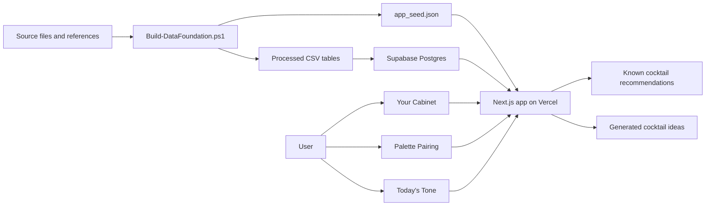
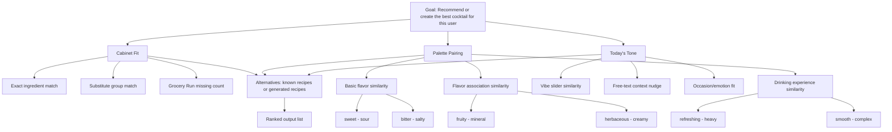

# Grassroots Cocktail Recommender: Technical Documentation for Final Presentation

This document is organized around the class rubric sections:

- 5. Data Acquisition or Generation Plan
- 6. System, Modeling, and Architecture
- 7. Analysis and Scenario Studies

It also documents how the Analytic Hierarchy Process (AHP) is integrated into the design methodology.

## System Summary

Grassroots is a cocktail recommender and creative drink-generation system. It is designed for users with small or incomplete home bars. The system asks users to enter their current cabinet, palette preferences, and vibe preferences, then supports two modes:

1. Create a known cocktail: rank existing cocktail recipes that the user can make or nearly make.
2. Create a new cocktail for me: generate original drink ideas using classic cocktail templates, ingredient roles, cabinet constraints, and flavor synergy rules.

The project uses a Vercel-ready Next.js frontend, a Supabase/Postgres database design for accounts and saved cabinets, and a local seed data package generated from the current spreadsheet and starter recipe files.

## 5. Data Acquisition or Generation Plan

### Current Data Inventory

The current processed data package is generated by `scripts/Build-DataFoundation.ps1`.

| Dataset | Current Count | File |
| --- | ---: | --- |
| Ingredient flavor vectors | 100 | `data/processed/ingredient_flavor_vectors.csv` |
| Canonical ingredients | 104 | `data/processed/ingredients.csv` |
| Starter recipes | 41 | `data/processed/recipes.csv` |
| Recipe-ingredient rows | 147 | `data/processed/recipe_ingredients.csv` |
| Cocktail-level flavor vectors | 41 | `data/processed/recipe_flavor_vectors.csv` |
| Substitute groups | 64 | `data/processed/substitute_groups.csv` |
| Vibe dimensions | 5 | `data/processed/vibe_dimensions.csv` |
| App-facing seed bundle | 1 JSON bundle | `data/processed/app_seed.json` |

Only four recipe-only ingredients still lack flavor profiles: coconut cream, cola, fresh ginger, and white peach puree. The system flags these instead of inventing hidden scores.

### Data Sources

| Source | Current Project Use | Production Rationale |
| --- | --- | --- |
| Supplied quantitative flavor workbook | Imported ingredient names, ranks, categories, flavor percentages, map coordinates, confidence, source notes | Starter flavor vector table; confidence flags remain visible to the data pipeline |
| Supplied Difford top-100 PDF | Used only as provenance for ingredient ranking through the workbook | No Difford recipe content is scraped or redistributed |
| IBA starter recipe seed | 41 starter recipes with names, categories, ingredient names, and amounts | Clean seed corpus for known-cocktail recommendations |
| Mixology Tools | Candidate future expansion source | Strong fit because it has hierarchical ingredient taxonomy, inventory features, similarity analytics, API docs, and open-data positioning |
| TheCocktailDB | Candidate optional expansion source | Good for prototyping, but public production usage should respect API-key and endpoint limitations |
| FlavorDB | Future flavor descriptor enrichment | Supports molecular and descriptor-level flavor pairing research |
| USDA FoodData Central | Future composition enrichment | Public-domain source for sugar, fat, sodium, and related composition fields |
| MDPI spirits flavor-wheel paper | Reference for spirit-category flavor calibration | Useful for improving confidence in spirit descriptors |

Important source governance decisions:

- We do not use Difford recipes in the application database.
- We do not use the Wikipedia folder from the IBA GitHub repository.
- Recipe methods are not copied from source pages; the current seed stores factual recipe names, ingredient names, and amounts.
- The source registry is kept in `data/processed/source_registry.csv`.

### Data Pipeline

The data pipeline is designed for traceability and repeatability.

```text
Local source files and selected open-data references
  -> manual seed files
  -> Build-DataFoundation.ps1
  -> normalized processed CSV tables
  -> app_seed.json for local frontend runtime
  -> Supabase CSV import for deployed database
```

Pipeline stages:

1. Source registry creation
   - Captures source ID, source name, source URL, imported fields, license/use notes, and production-use notes.

2. Ingredient canonicalization
   - Converts ingredient names into stable `canonical_ingredient_id` values.
   - Creates `normalized_name` for matching.
   - Creates `substitute_group_id` for cabinet matching.

3. Alias resolution
   - Uses `data/manual/ingredient_aliases_seed.csv`.
   - Example: Cointreau maps to the canonical orange liqueur profile.
   - Example: bourbon and rye can both satisfy the broader whiskey family when matching user inventory.

4. Recipe normalization
   - Stores recipe rows separately from recipe-ingredient rows.
   - Uses `recipe_id` and `line_no` as stable relationship keys.

5. Flavor vector derivation
   - Ingredient flavor vectors come from the workbook.
   - Recipe vectors are weighted averages of ingredient vectors using approximate milliliter conversions.

6. App seed export
   - `app_seed.json` bundles ingredients, recipes, recipe ingredients, recipe flavor vectors, and vibe dimensions.
   - This lets the Next.js app run locally without a live database.

7. Supabase import
   - The same processed CSVs are imported into Supabase/Postgres for the deployed version.
   - Import order is documented in `database/import-order.md`.

### Merge Keys and Data Model

The system uses three main ingredient keys:

| Key | Purpose | Example |
| --- | --- | --- |
| `canonical_ingredient_id` | Stable ingredient ID | `lime_juice_freshly_squeezed` |
| `normalized_name` | Exact/alias matching | `lime_juice_freshly_squeezed` |
| `substitute_group_id` | Substitution logic | `citrus_juice_lime` |

Recipe keys:

| Key | Purpose |
| --- | --- |
| `recipe_id` | Stable cocktail identifier |
| `line_no` | Ingredient line within a recipe |
| `canonical_ingredient_id` | Link from recipe line to ingredient table |
| `substitute_group_id` | Link from recipe line to cabinet substitution logic |

### Data Quality Controls

The pipeline includes several quality-control concepts:

- `flavor_profile_status`: whether a recipe ingredient has a flavor vector.
- `flavor_profile_coverage_ratio`: how much of a recipe's approximate volume is covered by known vectors.
- `confidence`: inherited from the ingredient flavor workbook.
- `review_status`: distinguishes starter profiles from items needing profile review.
- `unmatched_recipe_ingredients.csv`: flags missing ingredient profiles rather than silently filling them.

## 6. System, Modeling, and Architecture

### Vercel Application Design

The frontend is a Next.js app designed for Vercel deployment.

Important files:

- `package.json`: Next.js, React, Supabase, and Lucide icon dependencies.
- `vercel.json`: Vercel framework/build command configuration.
- `src/app/page.tsx`: app entry point.
- `src/components/RecommenderApp.tsx`: main user experience.
- `src/lib/recommender.ts`: known-cocktail scoring.
- `src/lib/creation.ts`: generated-cocktail engine.
- `src/lib/supabase.ts`: browser Supabase client.

Vercel is appropriate because Next.js deployment on Vercel is zero-configuration and supports global scalability. Vercel's Next.js docs describe the platform as providing zero-configuration deployment with global scalability, availability, and performance.

### Supabase/Postgres Design

Supabase is used because the project needs accounts and saved liquor cabinets, but only for roughly 10-20 users. Supabase provides:

- Email-based authentication
- Postgres database tables
- Browser-accessible APIs
- Row Level Security

The schema is in `database/schema.sql`.

Reference tables:

- `source_registry`
- `substitute_groups`
- `ingredients`
- `ingredient_flavor_vectors`
- `recipes`
- `recipe_ingredients`
- `recipe_flavor_vectors`
- `vibe_dimensions`

User tables:

- `profiles`
- `user_cabinet_items`
- `user_preference_sets`
- `user_vibe_preferences`

Security model:

- Public read access is allowed for cocktail, ingredient, source, and vibe reference tables.
- User-specific cabinet and preference rows are protected by Supabase Row Level Security.
- Users can only manage rows where `auth.uid()` equals their own `user_id`.

### Functional Architecture



### Modeling Components

#### Cabinet Fit Model

Cabinet fit is evaluated in layers:

1. Exact ingredient match.
2. Substitute group match.
3. Missing ingredient count.

This lets the system recommend a cocktail if the user has a functional substitute. For example, a user with Cointreau can satisfy recipes asking for triple sec.

The Grocery Run feature is not a separate recipe database. It is a filtered view over the same recipes where the user is missing one or two substitute groups.

#### Palette Pairing Model

Palette Pairing uses three flavor maps:

1. Basic flavor
   - X-axis: sweet minus sour
   - Y-axis: bitter minus salty

2. Flavor association
   - X-axis: fruity minus mineral
   - Y-axis: herbaceous minus creamy

3. Drinking experience
   - X-axis: refreshing minus heavy
   - Y-axis: smooth minus complex

User map clicks are converted into target coordinates. Each known cocktail also has recipe-level coordinates derived from its ingredient vectors. Similarity is computed with normalized Euclidean distance on each map.

#### Today's Tone Model

Today's Tone uses five vibe sliders:

- Mellow to Bright
- Cozy to Fresh
- Easy to Adventurous
- Casual to Elegant
- Light to Indulgent

The free-text prompt applies lightweight keyword nudges. Example: a phrase such as "lounge chair in the sunny lawn" nudges the system toward bright, fresh, light, and casual results.

#### New Cocktail Generation Model

The generated-cocktail mode uses classic cocktail templates rather than random ingredient mixing.

Templates:

- Bright Sour
- Lawn Highball
- Garden Daisy
- Porch Spritz
- Evening Stirred
- Velvet Treat

Ingredient roles:

- Base
- Acid
- Sweetener
- Modifier
- Lengthener
- Accent
- Texture

Synergy rules are explicit. Example:

- Gin pairs with lemon, lime, mint, elderflower, dry vermouth, and maraschino.
- Rum pairs with lime, pineapple, orgeat, ginger, and cream/coconut.
- Whiskey pairs with lemon, honey, ginger, sweet vermouth, and aromatic bitters.

This design supports creativity while remaining explainable.

## AHP Integration

### Why AHP Fits This System

The system makes a multi-criteria decision: recommend or create a cocktail that balances what the user owns, what the user wants to taste, and what the user wants to feel. AHP is appropriate because it decomposes the recommendation goal into a hierarchy of criteria and subcriteria, then synthesizes weighted scores into a final rank.

Classical AHP uses pairwise comparisons to derive priority weights. In the current app, the user-facing sliders operationalize those weights directly. This is a practical simplification for a low-friction prototype, but the hierarchy and scoring are still AHP-shaped: weights are normalized at each hierarchy level, subcriteria roll up into parent criteria, and final scores are synthesized across alternatives.

### AHP Hierarchy



### AHP Scoring Method

At the top level:

```text
top_weights = normalize(cabinet_weight, palette_weight, vibe_weight)
```

For each cocktail alternative `j`:

```text
overall_score_j =
  w_cabinet * cabinet_score_j +
  w_palette * palette_score_j +
  w_vibe * vibe_score_j
```

Palette Pairing is itself a sub-hierarchy:

```text
palette_weights = normalize(basic_weight, association_weight, experience_weight)

palette_score_j =
  w_basic * basic_similarity_j +
  w_association * association_similarity_j +
  w_experience * experience_similarity_j
```

Each flavor similarity score is computed from distance between the user's selected map coordinate and the cocktail's recipe coordinate:

```text
similarity = 1 - min(distance(user_point, cocktail_point) / max_possible_distance, 1)
```

Cabinet score:

```text
cabinet_score =
  1.00 if no required substitute groups are missing
  lower if 1 or 2 groups are missing
  much lower if 3 or more groups are missing
```

Vibe score:

```text
vibe_score =
  average similarity between target vibe dimensions and inferred cocktail vibe dimensions
```

### Pairwise AHP Extension

For a more formal AHP implementation, the sliders can be replaced or supplemented by pairwise comparisons.

Example top-level pairwise matrix:

| Criteria | Cabinet | Palette | Tone |
| --- | ---: | ---: | ---: |
| Cabinet | 1 | a12 | a13 |
| Palette | 1/a12 | 1 | a23 |
| Tone | 1/a13 | 1/a23 | 1 |

The priority vector can be derived from the normalized principal eigenvector or geometric mean method. Consistency can be evaluated with:

```text
CI = (lambda_max - n) / (n - 1)
CR = CI / RI
```

For the final presentation, this distinction matters:

- Current prototype: normalized sliders approximate AHP priority vectors.
- Proposed full system: pairwise comparison survey derives priority vectors and checks consistency.

### Where AHP Appears in the Code

| AHP Concept | Implementation File |
| --- | --- |
| Top-level criteria weights | `src/lib/recommender.ts`, `defaultWeights` and `normalizeWeightSet` |
| Palette subcriteria weights | `src/lib/recommender.ts`, `getPaletteScore` |
| Cabinet alternative scoring | `src/lib/recommender.ts`, `getRecommendations` |
| Vibe alternative scoring | `src/lib/recommender.ts`, `getVibeScore` |
| Generated alternative scoring | `src/lib/creation.ts`, `createNewCocktails` |
| User-facing weight controls | `src/components/RecommenderApp.tsx` |

## 7. Analysis and Scenario Studies

### Scenario 1: Sparse Cabinet, Practical Discovery

User cabinet:

- Gin
- Lemon juice
- Simple syrup
- Soda water

Expected behavior:

- Known-cocktail mode should surface gin sours, gin fizz-style drinks, and recipes that match the cabinet exactly or nearly exactly.
- Grocery Run should show recipes where only one or two substitute groups are missing.
- Generated mode should likely produce a Bright Sour or Lawn Highball.

What this demonstrates:

- The system supports users without a full bar.
- Substitute groups prevent overly strict matching.
- Grocery Run encourages low-friction experimentation.

### Scenario 2: Sunny Lawn Vibe

User vibe:

- Bright
- Fresh
- Casual
- Light
- Free text: "lounge chair in the sunny lawn"

Expected behavior:

- Known-cocktail mode prioritizes refreshing cocktails.
- Generated mode leans toward highball, spritz, sour, or daisy templates.
- Heavy or creamy drinks should rank lower unless the user changes AHP weights.

What this demonstrates:

- The vibe layer is not just aesthetic; it changes ranking behavior.
- The same cabinet can yield different recommendations depending on context.

### Scenario 3: AHP Weight Sensitivity

Run the same user profile with three weight settings:

1. Cabinet-first
   - Cabinet: 70
   - Palette: 20
   - Tone: 10

2. Flavor-first
   - Cabinet: 20
   - Palette: 60
   - Tone: 20

3. Vibe-first
   - Cabinet: 20
   - Palette: 25
   - Tone: 55

Expected behavior:

- Cabinet-first favors what the user can make now.
- Flavor-first favors closest coordinate similarity.
- Vibe-first favors contextual/emotional fit even if the recipe is not the closest flavor match.

What this demonstrates:

- AHP provides explainable ranking changes.
- The system can adapt to different user decision styles.

### Scenario 4: Known Cocktail vs New Cocktail

User selects:

- Tequila
- Lime
- Triple sec

Mode 1: Create a known cocktail

- Margarita-like recipes should rank highly.

Mode 2: Create a new cocktail for me

- The system can generate a Garden Daisy variation using tequila, lime, orange liqueur, and optional agave or grapefruit depending on vibe.

What this demonstrates:

- Known-recipe matching and creative generation use the same cabinet/flavor/vibe foundation.
- The creative mode is constrained by cocktail structure rather than free-form invention.

### Scenario 5: Data Coverage Stress Test

Test recipes with low `flavor_profile_coverage_ratio`, such as drinks involving cola, coconut cream, ginger, or white peach puree.

Expected behavior:

- The system still ranks recipes, but documents lower flavor-vector coverage.
- Data quality flags identify where additional flavor profiles should be generated.

What this demonstrates:

- The system is transparent about uncertainty.
- Data expansion work can be prioritized systematically.

## Recommended Presentation Talking Points

### For Section 5: Data Acquisition or Generation Plan

- We use an auditable data foundation rather than opaque scraped data.
- We separate imported data, reference data, and candidate future sources.
- The core join strategy uses canonical IDs, normalized names, and substitute groups.
- Missing or low-confidence data is flagged instead of hidden.

### For Section 6: System, Modeling, and Architecture

- Vercel/Next.js handles the frontend and interactive recommendation experience.
- Supabase/Postgres stores users, saved cabinets, preferences, recipes, ingredients, and flavor vectors.
- The recommender combines deterministic scoring with AHP-style weighting.
- Creative generation uses cocktail templates and synergy rules.

### For Section 7: Analysis and Scenario Studies

- Compare cabinet-first, flavor-first, and vibe-first weights.
- Demonstrate known-cocktail and generated-cocktail modes using the same user input.
- Show Grocery Run as a scenario output for constrained cabinets.
- Discuss data coverage and confidence as analytical limitations.

## Key Limitations

1. The current recipe corpus is intentionally small.
2. Many flavor profiles are inferred rather than lab-measured.
3. Current AHP uses normalized sliders rather than formal pairwise comparison matrices.
4. Vibe matching is currently heuristic, not machine-learned.
5. Creative generation is rule-based and should be validated by taste testing.

## Future Improvements

1. Expand the recipe corpus through Mixology Tools or another approved open data source.
2. Add formal AHP pairwise comparison screens and consistency ratio checks.
3. Add ingredient intensity scalars so neutral and intense ingredients are not over-weighted equally.
4. Enrich flavor profiles with USDA composition and FlavorDB descriptor data.
5. Add user feedback loops such as too sweet, too sour, too strong, more refreshing, or more adventurous.
6. Add ABV, sweetness, acidity, cost, and shelf-life calculations.

## External References

- IBA cocktails dataset: https://github.com/rasmusab/iba-cocktails
- Mixology Tools: https://mixology.tools/
- TheCocktailDB API: https://www.thecocktaildb.com/api.php
- FlavorDB paper: https://academic.oup.com/nar/article/46/D1/D1210/4559748
- USDA FoodData Central: https://fdc.nal.usda.gov/
- Vercel Next.js docs: https://vercel.com/docs/frameworks/nextjs
- Supabase Auth docs: https://supabase.com/docs/guides/auth
- Supabase Row Level Security docs: https://supabase.com/docs/guides/database/postgres/row-level-security
- Saaty AHP reference summary: https://www.inderscience.com/info/inarticle.php?artid=17590
